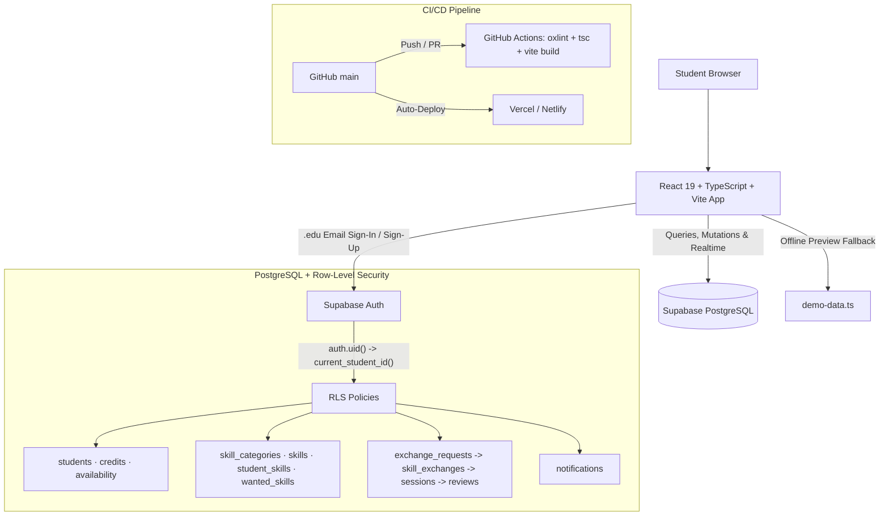

# 🎓 Campus Skill Exchange (`skillswap.`)

[](https://github.com/vaishnavisingh095/campus-skill-exchange/actions/workflows/ci.yml)
[](https://react.dev/)
[](https://www.typescriptlang.org/)
[](https://supabase.com/)

A peer-to-peer **campus learning and skill-exchange platform** where university students teach what they know, learn what they want, earn skill credits, schedule sessions, and rate completed exchanges—without any monetary transactions.

---

## 🏗️ System Architecture



---

## ✨ Key Features

- **🔐 Campus `.edu` Auth & Row-Level Security:** Sign in / sign up with campus email (`frontend/src/lib/supabase.ts`). PostgreSQL RLS policies (`database/01_schema.sql`) ensure students can only edit their own skill listings, requests, sessions, and reviews.
- **🤝 Reciprocal Skill Matching:** Automatically surfaces two-way matches where Peer A teaches what Peer B wants and vice versa.
- **🔍 Instant Search, Filters & Skill Tags:** Filter matches in real time by **category**, **proficiency level** (`Beginner` / `Intermediate` / `Advanced` / `Expert`), **availability** (`weekdays` / `evenings` / `weekends` / `flexible`), **minimum credits**, and clickable **skill tags**.
- **📅 Live Booking Workflow (`pending` → `accepted` → `completed`):** Send/accept requests, schedule online or in-person sessions, mark sessions completed (`+2` mentor credits), and submit **1–5 ★ ratings & feedback**—synced live via Supabase Realtime.
- **⚡ Offline Demo Fallback:** Works immediately out of the box with `demo-data.ts` if Supabase credentials are not configured yet.

---

## 🗄️ Database & Project Structure

```text
Campus Skill exchange/
├── .github/workflows/ci.yml   # GitHub Actions (oxlint + tsc + vite build)
├── database/
│   ├── 01_schema.sql          # Tables, indexes, and RLS policies
│   ├── 02_seed_data.sql       # Synthetic campus dataset
│   ├── 03_queries.sql         # Matching, filtering & booking queries
│   └── 04_reset_seed.sql      # Reset & re-seed helper
├── frontend/
│   ├── src/
│   │   ├── App.tsx            # Main React app (Overview, Discover, Requests, Exchanges, Sessions, Profile)
│   │   ├── lib/supabase.ts    # Supabase client + campus .edu auth helpers
│   │   └── demo-data.ts       # Offline read-only fallback snapshot
│   └── vercel.json            # Vercel SPA deployment config
├── netlify.toml               # Netlify build & SPA redirect config
├── architecture.md            # System architecture & workflow lifecycle
├── plan.md                    # Phased delivery roadmap
└── decision.md                # Key engineering trade-offs
```

---

## 🚀 Quick Start (Local Development)

### 1. Database Setup (Supabase)
In your Supabase **SQL Editor**, run the scripts in order:
1. `database/01_schema.sql` (creates tables, indexes, and Row-Level Security policies)
2. `database/02_seed_data.sql` (populates synthetic campus students, skills, and exchanges)

### 2. Frontend Setup
```bash
git clone https://github.com/vaishnavisingh095/campus-skill-exchange.git
cd "campus-skill-exchange/frontend"
npm install
```

Create `frontend/.env.local` (never committed):
```env
VITE_SUPABASE_URL=https://your-project.supabase.co
VITE_SUPABASE_ANON_KEY=your-anon-key
```

Start the dev server:
```bash
npm run dev
```
*(If `.env.local` is omitted, the app automatically loads the read-only `demo-data.ts` preview.)*
