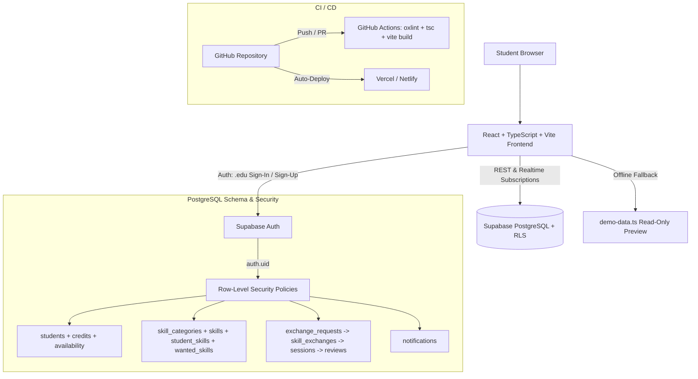

# Campus Skill Exchange — System Architecture

## 1. Overview

**Campus Skill Exchange** is a peer-to-peer campus learning platform where students exchange skills without monetary transactions. Students list skills they can teach, skills they want to learn, and their weekly availability; the platform discovers reciprocal matches, manages booking requests (`pending` -> `accepted` -> `completed`), tracks skill credits, and collects post-session ratings.

---

## 2. High-Level Architecture

---

## 3. Data & Workflow Lifecycle

1. **Discovery & Matching:** `App.tsx` computes reciprocal two-way matches (`myTeaching` intersects `peerWants` AND `peerTeaches` intersects `myWanted`) and supports instant filtering by category, proficiency level, availability, minimum credits, and skill tags.
2. **Booking State Machine:**
   - `exchange_requests`: `pending` -> `accepted` | `rejected` | `cancelled`
   - Accepting a request atomically creates a `skill_exchanges` record (`scheduled`).
   - `sessions`: `scheduled` -> `completed` (awards `+2` mentor credits and unlocks 1–5 star `reviews`).
3. **Real-Time Sync:** Supabase Realtime (`postgres_changes`) listens to `exchange_requests` and `sessions` so incoming bookings and completions appear without manual refreshes.
